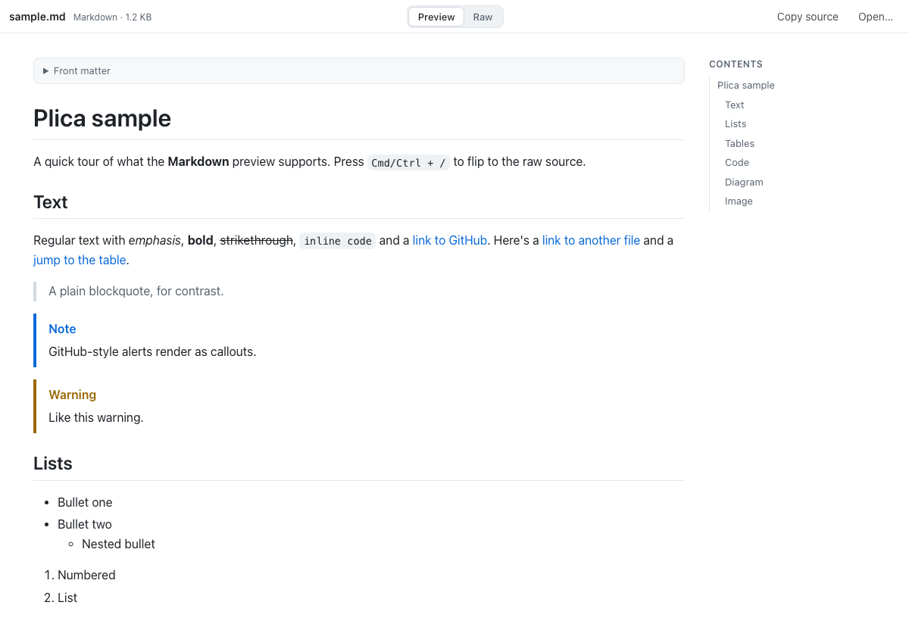
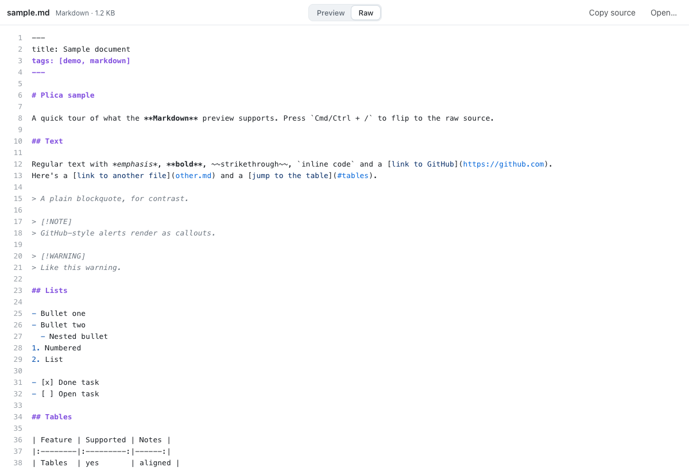
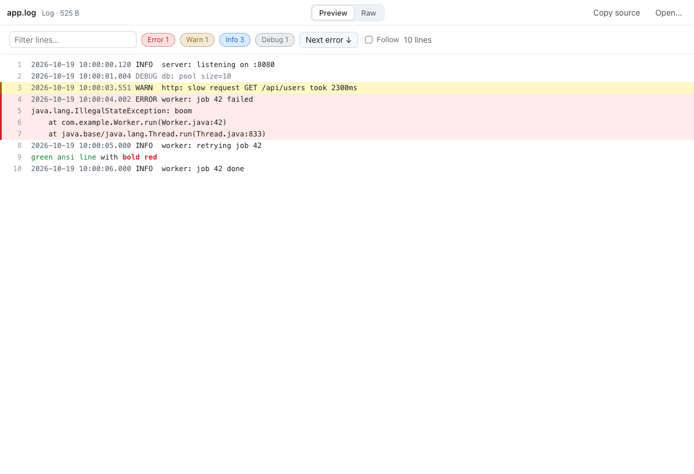
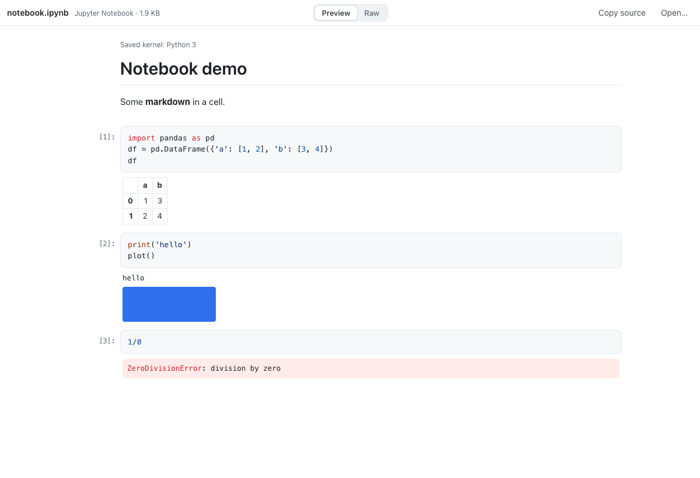
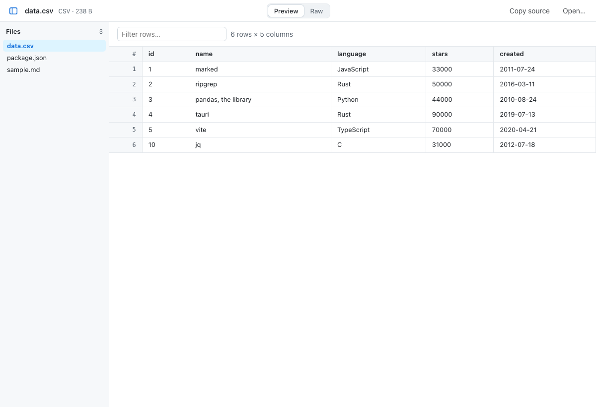

<p align="center">
  
</p>

<h1 align="center">Plica</h1>

<p align="center">
  <a href="https://github.com/ryangswe/plica/releases/latest"></a>
  <a href="https://github.com/ryangswe/plica/actions/workflows/ci.yml"></a>
  <a href="LICENSE"></a>
  
</p>

**Double-click a Markdown file and actually read it.**

Plica is a small, free viewer for the text files developers read every day. It opens Markdown, JSON, CSV,
Jupyter notebooks, logs, diffs and more **rendered**, instantly, without an IDE. Press
<kbd>Cmd</kbd>/<kbd>Ctrl</kbd> + <kbd>/</kbd> to flip to the raw source and back, like GitHub's Preview and Code
tabs.

<p align="center">
  
  
</p>

- **Small and fast.** Built with [Tauri](https://tauri.app), it uses the web engine your OS already has: the
  macOS app is about 5 MB, not a 150 MB Electron bundle.
- **Opens like any other file.** Make it the default app for `.md` (and friends) and double-click.
- **Read-only and careful.** File content is treated as untrusted: scripts never run, HTML is sanitized, and HTML
  pages preview in a sandbox.
- **Private.** No telemetry, no accounts, no update checks. Remote images in a file (badges, tracking pixels)
  load only when you say so.
- **Live reload.** Edit the file in your editor and the view updates when you save.
- **Finds what your coding agent just wrote.** File → Recent Changes lists the Markdown and text files changed
  this week, newest first, including plans in `~/.claude/plans` and notes in git worktrees.

## What it renders

| File | Preview |
|---|---|
| Markdown (`.md`, `.markdown`; `.mdx` as plain Markdown, components aren't run) | GitHub-style: tables, task lists, alerts (`> [!NOTE]`), syntax-highlighted code, Mermaid diagrams, front matter, table of contents, relative images and links |
| JSON / JSONC / JSON Lines | Collapsible tree, expand/collapse all; tolerates comments and trailing commas (`tsconfig.json`) |
| CSV / TSV | Table with sticky header, click-to-sort (numeric aware), filter |
| Jupyter (`.ipynb`) | Markdown and code cells with outputs: text, tables, images, errors |
| Logs (`.log`) | Color by level, stack traces grouped with their error, filter, level toggles, jump to next error, follow |
| Diffs (`.diff`, `.patch`) | GitHub-style per-file view with line numbers |
| Mermaid (`.mmd`) | Rendered diagram |
| SVG, HTML | Image / sandboxed page preview |
| Anything else that's text | Syntax-highlighted source with line numbers |

Text in UTF-16, Windows-1252, Shift_JIS and other legacy encodings is detected; click the encoding in the top bar
to pick another one if the characters look wrong.

<p align="center">
  
  
</p>

## Install

**macOS:** paste this into Terminal:

```bash
curl -fsSL https://raw.githubusercontent.com/ryangswe/plica/main/scripts/install-macos.sh | bash
```

It downloads the latest release for your Mac, checks it against the SHA-256 that GitHub lists for it, and installs
it in `/Applications`, so it opens without a security warning. ([Read the script](scripts/install-macos.sh) first
if you like.)

**Or download** the file for your system from the [latest release](https://github.com/ryangswe/plica/releases/latest):

| System | File |
|---|---|
| macOS, Apple Silicon | `Plica_<version>_aarch64.dmg` |
| macOS, Intel | `Plica_<version>_x64.dmg` |
| Windows | `Plica_<version>_x64-setup.exe` (or the `.msi`) |
| Linux | `.AppImage`, `.deb` or `.rpm` |

Plica isn't notarized by Apple or signed for Windows (both cost a yearly fee, and Plica is a free side project),
so a downloaded copy shows a warning the first time it opens:

- **macOS:** "Apple could not verify "Plica" is free of malware…". Click **Done**, go to **System Settings →
  Privacy & Security**, and click **Open Anyway** next to the message about Plica. You only do this once. (Or run
  `xattr -dr com.apple.quarantine /Applications/Plica.app` in Terminal, which skips it.)
- **Windows:** in the SmartScreen dialog, click **More info → Run anyway**.

Or build it yourself: see [Development](#development).

### Make it the default for Markdown

- **macOS:** Plica offers it the first time you open a Markdown file, and **Plica → Default Apps…** lets you pick
  any of the file types below in one go. (Or the manual way: **Get Info** → **Open with:** Plica → **Change All…**)
- **Windows:** right-click a `.md` file → **Open with** → **Choose another app** → Plica → tick **Always**.
- **Linux:** `xdg-mime default Plica.desktop text/markdown` (or use your file manager's "Open With").

Plica registers itself for Markdown, JSON, CSV/TSV, notebooks, logs, diffs and Mermaid files, so it shows up in
"Open With" for all of them.

## Using it

**Several files or a folder.** Select files in Finder or Explorer and open them, or drop files or a folder on
Plica (on macOS also **File → Open Folder…**). You get one window with the files listed on the left in Finder's
name order; click one, or use the arrow keys, to show it. To give a file a window of its own, Cmd/Ctrl-click
it, drag it out of the window, or right-click it → Open in New Window. Only the folder's own text files are
listed: subfolders, hidden files and files that aren't text are left out. Prefer tabs? On macOS,
Window → **Open Groups of Files as Tabs** opens one tab per file instead.

<p align="center">
  
</p>

**Recent changes.** **File → Recent Changes** (<kbd>Shift</kbd> <kbd>Cmd/Ctrl</kbd> <kbd>R</kbd>, or the
button on the start screen) lists the Markdown and text files
changed in the last 7 days, newest first, with their folder and when they changed. It looks in
`~/.claude/plans` and the usual code folders (`~/Workspace`, `~/Projects`, `~/Developer`, `~/code`…), skipping
dependencies and build output. Files written dozens at a time (a git checkout or a copy) are left out. To choose
the folders, add `"recentFolders": ["~/work", "~/notes"]` to Plica's `settings.json`. Run it again to refresh
the list.

**Links.** Web links open in your browser. Links to other files open them in Plica, including the
`src/main.ts:42` form that coding agents write (the line number is ignored for now).

**Remote images** stay blocked until you click **Load once** or **Always load** (macOS: View → Load Remote
Images).

### Keyboard

| Keys | Action |
|---|---|
| <kbd>Cmd/Ctrl</kbd> <kbd>/</kbd> | Toggle Preview ↔ Raw |
| <kbd>Cmd/Ctrl</kbd> <kbd>F</kbd>, <kbd>G</kbd>, <kbd>Shift</kbd> <kbd>G</kbd> | Find in file, next match, previous match |
| <kbd>Cmd/Ctrl</kbd> <kbd>O</kbd> | Open a file |
| <kbd>Cmd/Ctrl</kbd> <kbd>R</kbd> | Reload |
| <kbd>Shift</kbd> <kbd>Cmd/Ctrl</kbd> <kbd>R</kbd> | Recent changes |
| <kbd>Cmd/Ctrl</kbd> <kbd>+</kbd> / <kbd>-</kbd> / <kbd>0</kbd> | Zoom |
| <kbd>Alt</kbd> <kbd>←</kbd> or <kbd>Cmd/Ctrl</kbd> <kbd>[</kbd> | Back (after following a link to another file) |
| <kbd>Ctrl</kbd> <kbd>Cmd</kbd> <kbd>S</kbd> (macOS), <kbd>Ctrl</kbd> <kbd>B</kbd> | Show or hide the file list |

On macOS everything is also in the menu bar, plus:

| Keys | Action |
|---|---|
| <kbd>Shift</kbd> <kbd>Cmd</kbd> <kbd>O</kbd> | Open a folder |
| <kbd>Cmd</kbd> <kbd>E</kbd> | Open in your editor (VS Code, Cursor, Zed…; pick one under File → Open in Other Editor) |
| <kbd>Shift</kbd> <kbd>Cmd</kbd> <kbd>C</kbd> / <kbd>Option</kbd> <kbd>Cmd</kbd> <kbd>C</kbd> | Copy the file's source / its path |
| <kbd>Cmd</kbd> <kbd>1</kbd>…<kbd>9</kbd>, <kbd>Ctrl</kbd> <kbd>Tab</kbd> | Switch tabs (Window → Merge All Windows puts windows in tabs) |
| <kbd>Shift</kbd> <kbd>Cmd</kbd> <kbd>M</kbd> | Merge All Windows |

## Development

You need Node 20 or later and Rust (stable). On Linux, also the WebKitGTK libraries:
`sudo apt install libwebkit2gtk-4.1-dev libappindicator3-dev librsvg2-dev patchelf`.

```bash
git clone https://github.com/ryangswe/plica.git
cd plica
npm install
npm run tauri dev          # run the desktop app with hot reload
npm run dev                # or just the UI in a browser (drag files onto the page)
npm run tauri build        # build installers for your OS into src-tauri/target/release/bundle
```

Tests: `npm test` (unit), `npm run test:e2e` (Playwright, Chromium and WebKit), and `cargo test --manifest-path
src-tauri/Cargo.toml`. [ARCHITECTURE.md](ARCHITECTURE.md) explains how the code is laid out, and adding a file
type is one file in `src/renderers/` plus a line in `src/renderers/index.ts`.

## How this was built

I built Plica for myself, with heavy use of AI coding tools (Claude Code). It is checked by unit tests, browser
tests in Chromium and WebKit (which also enforce the app's Content Security Policy), Rust tests, a lint for bug
patterns, a macOS smoke test of the installed app, and two outside reviews by AI models, not by people. I use it
every day on macOS. The Windows and Linux builds are built and tested in CI but get little use by hand, so
reports from those systems are especially welcome.

## Support

I maintain Plica in my spare time. Bug reports are welcome as
[issues](https://github.com/ryangswe/plica/issues/new/choose); they are read, but there is no promised response
time and no roadmap. Plica does what I need, so new features are unlikely unless they are small and fit what it
already does. To help with code, see [CONTRIBUTING.md](CONTRIBUTING.md). To report a security problem, see
[SECURITY.md](SECURITY.md) instead of opening an issue.

## License

[MIT](LICENSE). Changes by version are in [CHANGELOG.md](CHANGELOG.md).
