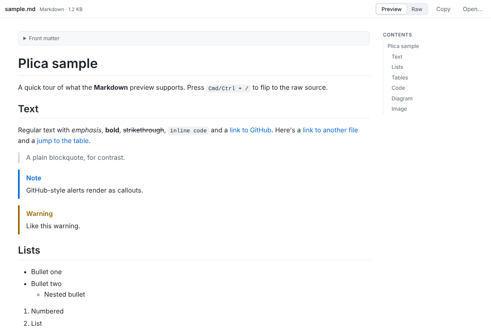
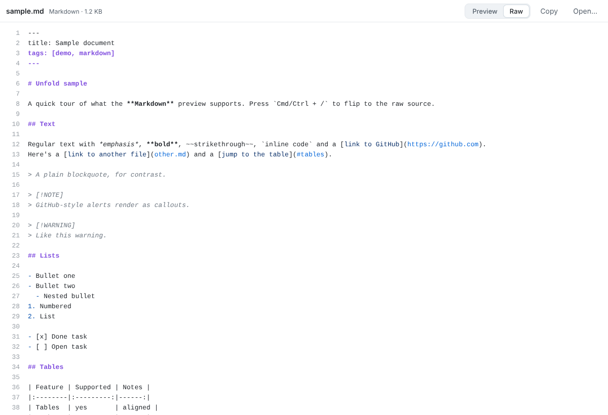
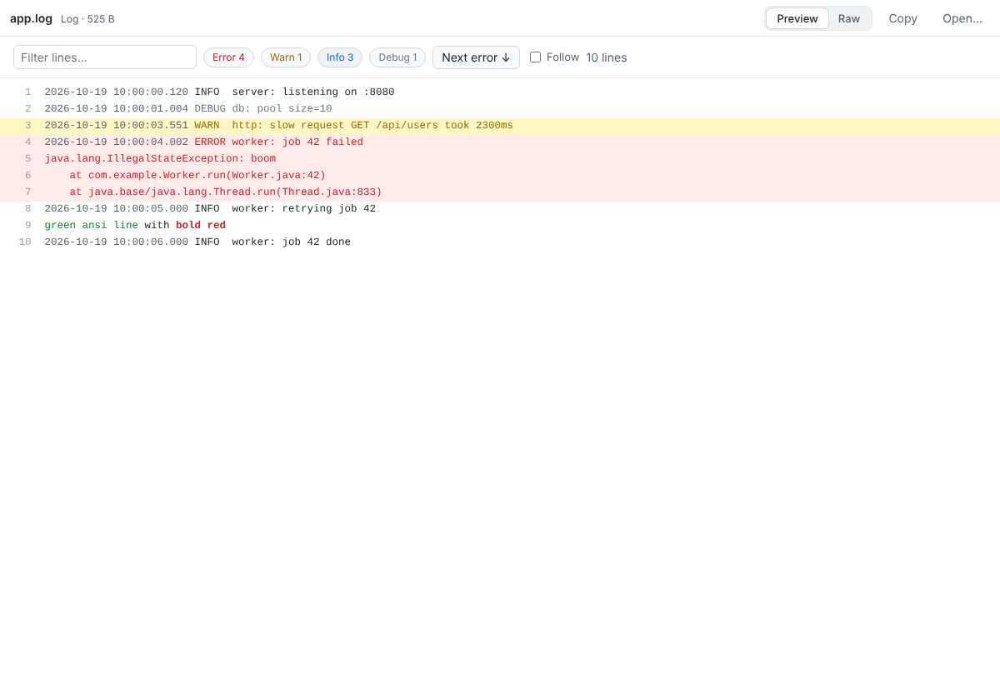
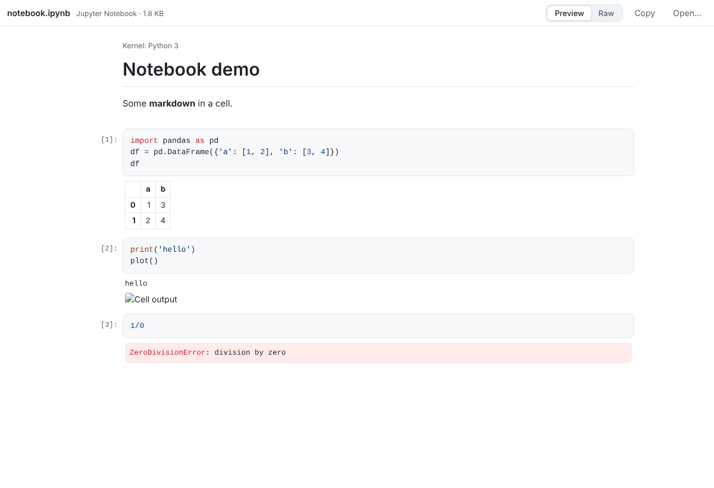

# Plica

**Double-click a Markdown file and actually read it.**

Plica is a tiny, free, open-source viewer for the text files developers deal with every day. It opens
Markdown, JSON, CSV, Jupyter notebooks, logs, diffs and more **rendered**, instantly, without an IDE. Press
<kbd>Cmd</kbd>/<kbd>Ctrl</kbd> + <kbd>/</kbd> to flip to the raw source and back, like GitHub's Preview / Code tabs.

<p align="center">
  
  
</p>

- **Fast and small.** Built with [Tauri](https://tauri.app): it uses the web engine your OS already has, so
  the app is a few MB instead of a 150 MB Electron bundle.
- **Opens like any other file.** Set it as the default app for `.md` (and friends) and double-click.
- **Read-only and safe.** Files are untrusted: scripts never run, HTML is sanitized, HTML pages preview in a sandbox.
- **Private.** No telemetry, no accounts. Remote images in a file (badges, tracking pixels) load only when you
  say so: **Load once**, or **Always load** (macOS: View → Load Remote Images).
- **Live reload.** Edit the file in your editor; the view updates on save (great for logs with *Follow* on).
- **Works on macOS, Windows and Linux.**

## What it renders

| File | Preview |
|---|---|
| Markdown (`.md`, `.markdown`; `.mdx` as plain Markdown, components aren't run) | GitHub-style: tables, task lists, alerts (`> [!NOTE]`), syntax-highlighted code, Mermaid diagrams, front matter, table of contents, relative images and links |
| JSON / JSONC / JSON Lines | Collapsible tree, expand/collapse all; tolerates comments and trailing commas (`tsconfig.json`) |
| CSV / TSV | Table with sticky header, click-to-sort (numeric aware), filter |
| Jupyter (`.ipynb`) | Markdown and code cells with outputs: text, tables, images, errors |
| Logs (`.log`) | Color by level, stack traces grouped with their error, filter, level toggles, jump to next error, follow |
| Diffs (`.diff`, `.patch`) | GitHub-style per-file view with line numbers |
| Mermaid (`.mmd`) | Rendered diagram |
| SVG, HTML | Image / sandboxed page preview |
| Anything else that's text | Syntax-highlighted source with line numbers |

<p align="center">
  
  
</p>

## Keyboard

| Keys | Action |
|---|---|
| <kbd>Cmd/Ctrl</kbd> <kbd>/</kbd> | Toggle Preview ↔ Raw |
| <kbd>Cmd/Ctrl</kbd> <kbd>F</kbd>, <kbd>G</kbd>, <kbd>Shift</kbd> <kbd>G</kbd> | Find in file, next match, previous match |
| <kbd>Cmd/Ctrl</kbd> <kbd>O</kbd> | Open a file |
| <kbd>Cmd/Ctrl</kbd> <kbd>R</kbd> | Reload |
| <kbd>Cmd/Ctrl</kbd> <kbd>+</kbd> / <kbd>-</kbd> / <kbd>0</kbd> | Zoom |
| <kbd>Alt</kbd> <kbd>←</kbd> or <kbd>Cmd/Ctrl</kbd> <kbd>[</kbd> | Back (after following a link to another file) |
| <kbd>Ctrl</kbd> <kbd>Cmd</kbd> <kbd>S</kbd> (macOS), <kbd>Ctrl</kbd> <kbd>B</kbd> | Show or hide the file list |

On macOS everything is also in the menu bar, plus:

| Keys | Action |
|---|---|
| <kbd>Cmd</kbd> <kbd>E</kbd> | Open in your editor (VS Code, Cursor, Zed…; pick one under File → Open in Other Editor) |
| <kbd>Shift</kbd> <kbd>Cmd</kbd> <kbd>C</kbd> / <kbd>Option</kbd> <kbd>Cmd</kbd> <kbd>C</kbd> | Copy the file's source / its path |
| <kbd>Cmd</kbd> <kbd>1</kbd>…<kbd>9</kbd>, <kbd>Ctrl</kbd> <kbd>Tab</kbd> | Switch tabs (Window → Merge All Windows to put windows in tabs) |
| <kbd>Shift</kbd> <kbd>Cmd</kbd> <kbd>M</kbd> | Merge All Windows |

**Several files or a folder:** select files in Finder and open them, drop them on Plica, or use **File → Open
Folder…** (Shift+Cmd+O, or drop a folder). You get one window with the files listed on the left in Finder's name
order; click one (or use the arrow keys) to show it. To give a file a window of its own, Cmd-click it, drag it
out of the window, or right-click it → Open in New Window. Only the folder's own text files are listed:
subfolders, hidden files and files that aren't text are left out. Prefer tabs? On macOS, Window → **Open Groups
of Files as Tabs** opens one tab per file instead.

If a file's characters look wrong, click its encoding in the top bar (or File → Reopen with Encoding) to pick another.

## Install

Download the installer for your OS from the [Releases](../../releases) page.

> **The app isn't code-signed yet**, so the first launch shows a warning:
> - **macOS:** right-click Plica.app → **Open** → **Open**. If macOS says the app is "damaged", run
>   `xattr -cr /Applications/Plica.app` once.
> - **Windows:** SmartScreen → **More info** → **Run anyway**.

### Make it the default for Markdown

- **macOS:** Plica offers it the first time you open a Markdown file, and **Plica → Default Apps…** lets you pick
  any of the file types below in one go. (Or the manual way: **Get Info** → **Open with:** Plica → **Change All…**)
- **Windows:** right-click a `.md` file → **Open with** → **Choose another app** → Plica → tick **Always**.
- **Linux:** `xdg-mime default Plica.desktop text/markdown` (or use your file manager's "Open With").

Plica registers itself for Markdown, JSON, CSV/TSV, notebooks, logs, diffs and Mermaid files, so it shows
up in "Open With" for all of them.

## Development

Requirements: Node 20+, Rust (stable), and on Linux the WebKitGTK libraries
(`sudo apt install libwebkit2gtk-4.1-dev libappindicator3-dev librsvg2-dev patchelf`).

```bash
npm install
npm run tauri dev          # run the desktop app with hot reload
npm run dev                # or just the UI in a browser (drag files onto the page)
npm test                   # unit tests (vitest)
npm run test:e2e           # browser tests (playwright) – also writes screenshots to test-results/screens
npm run tauri build        # build installers for your OS into src-tauri/target/release/bundle
```

Adding a file type is one file in `src/renderers/` plus a line in `src/renderers/index.ts`. See
[ARCHITECTURE.md](ARCHITECTURE.md) for how it's built.

## License

MIT
