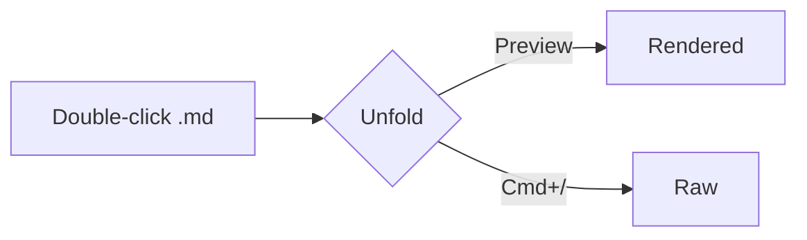

# Unfold sample

A quick tour of what the **Markdown** preview supports. Press `Cmd/Ctrl + /` to flip to the raw source.

## Text

Regular text with *emphasis*, **bold**, ~~strikethrough~~, `inline code` and a [link to GitHub](https://github.com).
Here's a [link to another file](other.md) and a [jump to the table](#tables).

> A plain blockquote, for contrast.

> [!NOTE]
> GitHub-style alerts render as callouts.

> [!WARNING]
> Like this warning.

## Lists

- Bullet one
- Bullet two
  - Nested bullet
1. Numbered
2. List

- [x] Done task
- [ ] Open task

## Tables

| Feature | Supported | Notes |
|:--------|:---------:|------:|
| Tables  | yes       | aligned |
| Tasks   | yes       | GFM   |

## Code

```python
def greet(name: str) -> str:
    """Say hello."""
    return f"Hello, {name}!"
```

```ts
const answer: number = 42;
export function double(n: number) { return n * 2; }
```

## Diagram



## Image


<details>
<summary>Collapsible HTML section</summary>

Hidden until you click.

</details>
